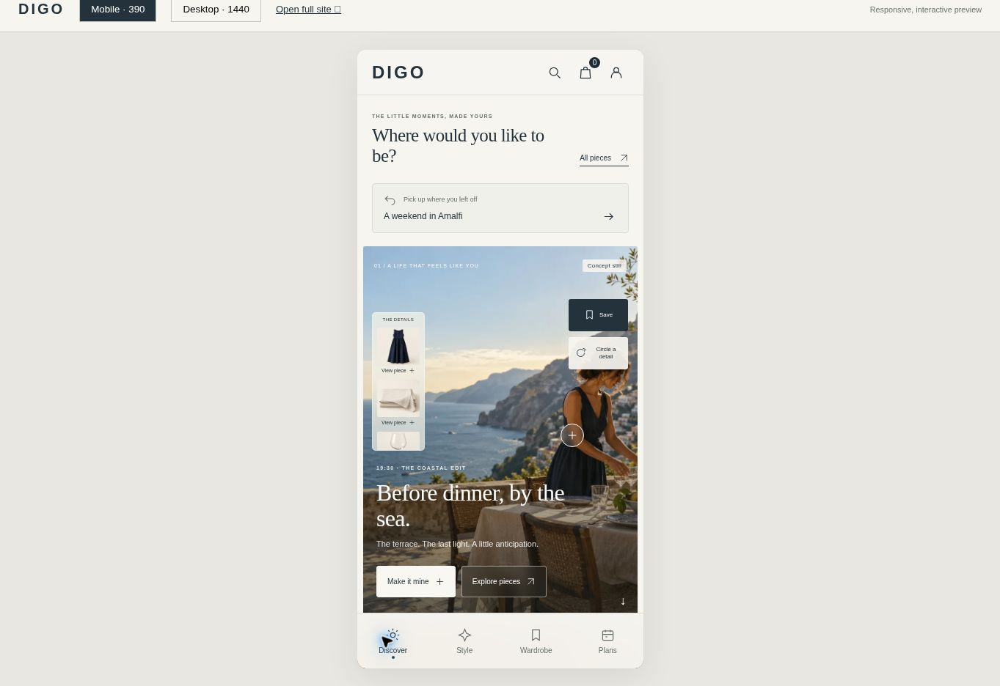
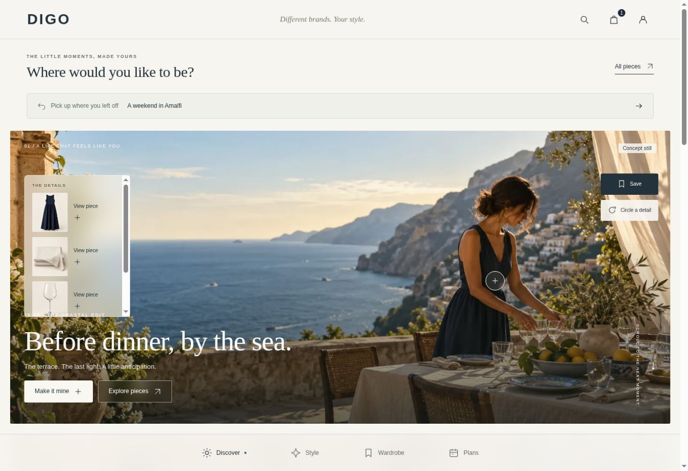

# DIGO UX 实施与验收记录

> 下文为本轮设计评审时的历史验收记录。2026-11-04 用户已确认发布当前版本；发布前重新通过 43 项测试及生产构建。后续挂衣式衣柜、付款确认后自动入柜与删字调整见 `docs/ux-review/WARDROBE_REVIEW.md`。生产部署状态以 Vercel 对应提交的部署记录为准。

检查日期：2026-11-04。状态：现有仓库中的交互实现已完成本地检查，尚未推送或部署；不能视为全部业务能力已经上线。

项目：`diga-deng/digo-store`；目录：`digo-store-diagnostic-upload`；分支：`ux/lifestyle-journeys`。
线上仍为 `c1e9265`。本地沿用已有的 `ddf981a`、`a206499` 体验实现，并继续修复上下文、保存、计划和分享异常。

## 页面与任务

| 页面 | 已实现的交互 | 当前边界 |
| --- | --- | --- |
| Discover / 场景 | 保留大幅画面、商品热点、手机左侧约 1/5 商品栏；具体生活瞬间、恢复入口、圈选、保存和搭配 | 当前是明确标注的概念静态图；没有伪装成真实同款或视频 |
| 全站导航 | Discover / Style / Wardrobe / Plans；顶部搜索、购物袋、账户；保留全部商品入口 | 品牌主页及独立品牌视觉需要真实品牌资料 |
| 商品抽屉与详情 | 手机底部抽屉、桌面侧栏；关闭回原位置；保存、搭配、现有购买选项及材料/服务展开 | 品牌、图片、SKU 库存、准确交期和材料视频尚不完整 |
| Make it mine | 单件替换、锁定、撤销/重做、自有物品、移除、预算与感觉记录、固定版本、选购部分 | 用商品组合板展示实际选择；没有声称实现换装或场景重生成 |
| Style | 图片探索、方向细调、圈选入口；无必填问卷 | 圈选自动识别尚未接入，先保存灵感 |
| Wardrobe / My World | 商品、搭配、场景、局部灵感、服装/家居分类、收藏组、独立浏览记录 | 已下单/已拥有与喜欢分开；真实订单自动同步尚未接入 |
| Plans | 一句话开始；日期、场合、地点、预算可编辑；引用候选版本及灵感；归档 | 不把未确认交期显示为保证；暂未接自然语言日期解析和目的地到货预测 |
| 好友帮选 | 固定 2–4 版本、问题、A/B 卡预览、PNG 导出、访客 API、改选、留言、结束/停用、返回原计划或搭配 | API 单元测试通过；线上真实独立访客验证因未部署而未执行 |
| 购物袋 / checkout | 原商品及购买逻辑继续使用；全价、本次应付、尾款分列；礼赠演示 | 礼盒/香气费用未混入真实付款；Stripe 尚缺完成支付所需配置 |
| 账户 / 长期服务 | 订单、护理、配件及回收位置清楚，未接能力标注 | 账号同步、订单关联、售后、回收、配件履约需要真实服务和业务规则 |

## 本轮继续修复

- 从保存版本开始新计划时，自动带入该版本及原场景；不再需要重新添加。
- 计划中移除灵感只解除计划引用，不删除衣柜中的原收藏。
- 圈选修改更新同一记录，不生成重复项；保存失败时保留圈选编辑界面。
- 最近看过的商品使用“Save to wardrobe”，不显示无效的收藏移除操作。
- 实际目录中的家居商品也按类别归入 Home。
- 相关商品卡继续携带原场景；外部商品参数支持产品 ID 或 slug。
- 已保存但不可售的商品保留已有名称、图片和历史价格，不静默替换。
- 好友投票分页读取全部记录；复访从访客 cookie 取回本人选项和留言；增加候选放大查看。
- 服务返回 HTML 等非 JSON 错误时，显示可理解的重试提示；不输出技术解析报错。
- 刷新目录时不重建正在输入的表单，避免覆盖尚未离开焦点的输入。
- 商品详情优先显示真实 brand 字段；无资料时继续明确标注缺失。

## 检查结果

自动测试 36/36 通过。覆盖原支付、预约、场景购物回归，以及锁定/替换/撤销、金额排除自有物品、固定版本、计划上下文、访客投票/改选/停用、106 条投票跨页汇总等。

类型检查、生产构建及 JavaScript 语法检查通过。API 测试在存储边界使用模拟 Supabase，不等于已验证真实线上存储。

| 验收任务 | 已观察结果 |
| --- | --- |
| 外部来源 → 对应商品 | 浏览器打开带 `scene=amalfi` 和真实目录商品参数的链接，立即出现 Lightweight Wool Scarf，并保留原场景入口。没有真实视频同款映射资料，不能验证该部分 |
| 查看后关闭 | 手机抽屉关闭后原场景和触发按钮位置保留 |
| 圈选与保存 | 390px 宽预览中拖选并保存，衣柜显示局部范围；再次调整保存后记录数量不变 |
| 未购买商品入衣柜 | 浏览器保存真实目录围巾；记录为喜欢，不生成订单或拥有状态 |
| 单件替换、锁定、撤销 | 已有浏览器验证与本轮纯状态测试通过；其他件和预算不被重置 |
| 新建计划及两个候选 | 从 B 版本建立新计划后自动包含 B 和原场景；再加入 A；重新进入后两者仍在 |
| 分享链接及独立好友 | 分享预览存在；本地创建失败显示“Sharing is not connected yet”，候选不丢失且不返回假链接；跨独立访客 cookie 的 API 测试通过，真实线上独立访问未验收 |
| 分享图导出 | 已有实际导出证据 `comparison-card.png`；本轮在预览 iframe 中再次等待下载超时，未把该次尝试计为成功 |
| 返回继续与状态变化 | 重新载入后恢复入口与计划候选保留；目录重读与变价/下架提示代码已实现，未修改线上目录做真实变价实验 |
| 商品 → 购物袋 → checkout | 本轮浏览器核对全价 $35、定金 $4.50、尾款 $30.50 一致；未提交付款 |
| 礼盒与香气 | 演示选项为礼盒 $12、香气卡 $3；商品 $35 加演示选项共 $50；真实下载的 JSON 与页面一致。它不是订单，实际订单选项一致性尚待接入后验收 |
| 手机 / 桌面 | 390px 响应式 iframe 和约 1348px 桌面浏览器检查；不是实际 iOS/Android 设备全矩阵测试 |

## 数据与服务依赖

1. 真实同款图片、品牌/系列资料、颜色尺码/SKU、库存、交付范围、护理和材料视频；当前目录主要是围巾等配饰，原场景裙子与家居为示意。
2. 6–12 秒场景短片、视频控件及时间点恢复、圈选识别。
3. Vercel 环境中已有 Supabase 变量名称；本轮未读取密钥值，也没有证明凭据有效。部署后需验证私有 `digo-help-choose` bucket、真实访客投票与发起者回传。正式扩大使用前需补限流、过期记录清理。
4. 账号、跨设备同步、订单及收货状态与衣柜关联。
5. Stripe 支付配置；礼盒、香气、合装、运费税费、配件、布样、纽扣、售后和回收的确认规则及履约接入。当前不承诺未经确认的费用或回购金额。

## 预览

以下为本轮从运行页面捕获的截图，不是已部署页面链接。

交互预览壳：`public/ux-preview.html`，在项目启动后支持 `?mode=mobile` 和 `?mode=desktop`。

## 发布阻碍与下一步

本轮推送 `ux/lifestyle-journeys` 到 `origin` 被自动审批拒绝。系统给出的理由是：向该 GitHub 目标推送源代码尚未得到用户明确授权。没有改用其他工具或目标绕过限制。

待用户明确授权向 `diga-deng/digo-store` 推送此分支并由现有 Vercel 项目生成预览后，才能完成真实服务验收并交付外部可访问的新版链接。线上站点尚未更新。
